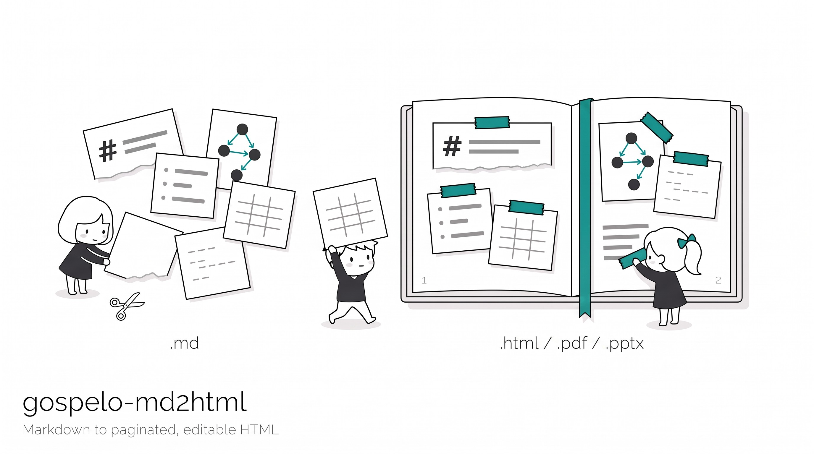

# gospelo-md2html

[](./LICENSE) [](https://nodejs.org/) [](https://www.typescriptlang.org/) [](https://pptr.dev/) [](https://mermaid.js.org/) [](https://docs.claude.com/en/docs/claude-code/skills)

<p align="center"></p>

Markdown + Mermaid から、**レイアウトを考慮してページ分割されたスライド資料や文書** を **自己完結した HTML 1 ファイル** として作ります。PDF と PPTX の出力にも対応しています。生成した HTML は **AI エージェントがそのまま編集して再生成でき**、**原文の Markdown を内部に保持** しています。名前は HTML ですが、HTML は正本であり、他の形式はそこから生成します。単なる Markdown から HTML への変換ではありません。

English version: [README.md](./README.md)

一般的な Markdown から PDF への変換は、ブラウザの印刷エンジンに文章を流し込むだけです。見出しがページ末尾に取り残され、表が任意の位置で切れ、図は縮みすぎるかはみ出し、HTML ができた後は 1 ページだけを直すこともできません。このスキルは次の 3 点を軸にしています。

1. **レイアウトを考慮したページ分割。** `import` が全ブロックをヘッドレスの Chrome (chrome-headless-shell) で描画して実寸の高さを取り、組版の規則 (見出しは本文と同じページに、表は行境界で分割してヘッダーを繰り返す、横長の用紙では 2 段に流す) で 16:9 / 4:3 のスライドや A4 / A3 の文書に割り付けます。
2. **AI で編集できる。** 出力は `.gospelo.html` 1 ファイル (**Gospelo Document**) で、その先頭に内容が JSON として置かれます: 1 ページ 1 オブジェクト、本文はインライン Markdown、表は `header` + `rows`、Mermaid はソース文字列。エージェントは該当ページを直して同じファイルに `build` するだけです。収まらなくなった分は同じタイトルの続きページへ自動で送られ、JSON と描画済みページは常に一致します。
3. **原文を保持する。** 取り込み時点の Markdown をファイルの中にそのまま保持し、`restore` でいつでも取り出せます。編集をやり直したいときは原文から `import` し直せます。

レイアウトはコンテンツに含めません。用紙、余白、文字階層、段の分割、図の側は CLI オプションか別のレイアウト JSON で与えます。Mermaid 図はビルド時に [mermaid-arch](https://github.com/gospelo-dev/mermaid-arch) (Mermaid 12、ELK による配置、AWS のアーキテクチャアイコン) で描画して SVG としてファイルに書き込み、ソースはエンベロープに残すので、図は編集可能なままでファイルは小さく保てます (Mermaid のライブラリを同梱しません)。

はじめての方は [クイックスタート](./docs/QUICKSTART_ja.md) ([English](./docs/QUICKSTART.md)) を参照してください。組版の規則とその根拠は [docs/DESIGN_ja.md](./docs/DESIGN_ja.md)、1 ファイル構成の設計は [docs/ARCHITECTURE_ja.md](./docs/ARCHITECTURE_ja.md)、ファイル形式は [docs/spec/gospelo-document_ja.md](./docs/spec/gospelo-document_ja.md) にあります。

## できること

| 機能 | 内容 |
| --- | --- |
| 用紙 | `a4`、`a4-landscape`、`a3`、`a3-landscape` (文書) と `16x9`、`4x3` (スライド) |
| 文字サイズ 1 つで組版 | 見出し、表、コード、余白、フッターの大きさは全て `--font-size` から導出 |
| スライド | h2 ごとに 1 枚。見出しはヘッダー帯に本文の 1.25 倍で表示し、続きスライドに「(続き)」を付ける |
| 2 段組 | 横長の用紙ではブロックを 2 段組 (左段 → 右段) で流す: 左段の上から下へ、次に右段へ。列数の多い表と横長の図は幅いっぱいの帯になる。縦長の用紙は単段。図 1 枚をテキストの隣に置く `split` も選べる |
| コードブロック | コードフェンスに言語名があれば Shiki でシンタックスハイライトする (JSON、bash、YAML、Python、JS/TS、HTML、CSS、SQL、TOML、Markdown、diff、Dockerfile)。色は静的なマークアップとしてファイルに書き込み、ハイライタ本体は同梱しない。2 段組ではコードを 1 段に収めて本文の 0.6 倍、それ以外は 0.85 倍で組む |
| 縦長の図 | 縮めると読めないほど縦長の Mermaid フローチャートは、ノードの間で切り分けて 1 つの SVG の中で 2 〜 4 段に並べる |
| 構成図 | 図に AWS のアーキテクチャアイコンを使える (`fn@{ icon: "aws:lambda", form: "square", label: "Handler" }`、または `architecture-beta`)。アイコンは手元の AWS のアイコン zip (`--icons-zip`) から取る。ファイルに入るのは描画した SVG だけで、アイコンパックそのものは書き出さない |
| 実測 | 高さは chrome-headless-shell (puppeteer-core) で実測し、推定しない。検証パスが全ページのはみ出しを確認する |
| 編集可能なコンテンツ | ページ単位の JSON。表の行、リスト項目、Mermaid ソースは素のデータ |
| 自動送り | 編集で収まらなくなった分は「(続き)」ページへ移す。内容を削ったり押し込んだりしない |
| Gospelo Document | `.gospelo.html` 1 ファイルが内容、レイアウト、原文 Markdown をファイル先頭のエンベロープに持ち、`check` / `build` / `restore` はそのファイルだけで動く。編集者 (やエージェント) に渡すのは 1 ファイルで済む。同じエンベロープを分離 JSON (`.gospelo.json`) として書くこともできる |
| 原文の保持 | 取り込み時点の Markdown をエンベロープのページ 0 にそのまま保持し、`restore` で取り出せる |
| レポート | ページごとの使用量と残り、表の行やリスト項目の高さ、図の縮小率、警告、送りの予定 |
| PDF と PPTX | `build --pdf` は同じブラウザで用紙サイズのまま印刷。`build --pptx` は見た目を固定した PowerPoint を書く: 1 ページ 1 枚の画像スライド (同じ描画)、見えないリンク領域、任意の透明テキスト層。PowerPoint 上で編集はできない (下の「PPTX 出力」を参照) |

## 前提

対応プラットフォーム: **macOS / Linux / WSL2**

| 依存 | 導入 |
| --- | --- |
| [Node.js](https://nodejs.org/) 22.12 以上 (npm を含む) | md2html は TypeScript で、`scripts/md2html.mjs` にまとめてある |
| [uv](https://docs.astral.sh/uv/) (任意) | `curl -LsSf https://astral.sh/uv/install.sh \| sh`。`scripts/md2html.py` は `md2html.mjs` を呼ぶだけの依存のない薄いラッパーで、`python3` でも動く |
| npm パッケージと chrome-headless-shell | 初回のみ `uv run <skill>/scripts/md2html.py setup` (`npm ci --omit=dev` の後、puppeteer-core が想定する版の chrome-headless-shell を puppeteer のキャッシュに入れる) |
| AWS のアーキテクチャアイコンの zip (`aws:` アイコンを使う場合だけ) | https://aws.amazon.com/architecture/icons/ から `Icon-package_*.zip` を入手し、`--icons-zip` で渡す |

mermaid-arch (Font Awesome Free を含む)、Shiki (シンタックスハイライト)、BIZ UD フォントはスキルに同梱しています。Mermaid 12 は同梱しません。そのバンドルは elkjs (EPL-2.0) を含み、このリポジトリには elkjs を入れないためです。`setup` がほかの npm パッケージと一緒に npm のレジストリから 1 度だけ入れ、実行時のダウンロードはありません ([THIRD_PARTY_NOTICES.md](./THIRD_PARTY_NOTICES.md))。ブラウザは `--chrome PATH`、`CHROME_PATH`、`PUPPETEER_EXECUTABLE_PATH`、puppeteer のキャッシュの順に探します。

## 使い方

```bash
S=skills/claude/gospelo-md2html/scripts/md2html.py

# 0. 初回のみ
uv run $S setup

# 1. Markdown -> out/handover.gospelo.html。16:9 スライド、本文 14pt (まず --dry-run でページ数と警告を確認)
uv run $S import docs/handover.md -o out/handover.gospelo.html --page 16x9 --font-size 14pt --dry-run
uv run $S import docs/handover.md -o out/handover.gospelo.html --page 16x9 --font-size 14pt

# 2. out/handover.gospelo.html 先頭のエンベロープを編集 (例: p05 の表に行を追加) し、送りの予定を確認
uv run $S check out/handover.gospelo.html --report out/report.json

# 3. 同じファイルを再生成 (PDF と PPTX も)。はみ出しは続きページへ送られ、ファイルに書き戻される
uv run $S build out/handover.gospelo.html --pdf out/handover.pdf --pptx out/handover.pptx

# AWS アイコンを使う図: その文書の import / check / build のたびに AWS のアイコン zip を渡す
uv run $S import docs/architecture.md --page 16x9 --icons-zip "<path to Icon-package_*.zip>"

# いつでも原文 Markdown に戻せる
uv run $S restore out/handover.gospelo.html -o out/handover.original.md

# 編集や差分に別ファイルの JSON を使いたい場合: 分離 JSON を書き、そこから build する
uv run $S import docs/handover.md -o out/handover.gospelo.json --page 16x9 --font-size 14pt
uv run $S build out/handover.gospelo.json --pdf out/handover.pdf     # out/handover.gospelo.html を書く
```

用紙と文字サイズはページ割りの入力なので `import` に渡します。値はファイルに記録されるので、後から変える場合は `build --reflow --page a4` のように指定してページ割り全体をやり直します。

### エンベロープ

`.gospelo.html` の最初の `<script>` (と `.gospelo.json` の全体) がエンベロープです: `format`、`version`、`generator`、`meta`、`layout`、`pages`。`pages[0]` は原文 Markdown、それ以外のページは 1 ページ 1 オブジェクトです。16:9 のコンテンツページ 1 つ分:

```json
{
  "id": "p05",
  "kind": "content",
  "title": "4. 環境とゲートの対応",
  "continued": false,
  "blocks": [
    { "type": "mermaid", "source": "flowchart LR\n  Feat[feature/*] --> Rel[release/*] --> Main[main]" },
    { "type": "heading", "level": 3, "text": "ゲート" },
    {
      "type": "table",
      "header": ["ゲート", "適用先", "内容"],
      "rows": [
        ["層 1", "`release/*`、`main` への PR", "CI が全通過"],
        ["層 2", "`release/*` -> `main`", "stg で E2E 全件通過"]
      ]
    }
  ]
}
```

ゲートを 1 つ足すには `rows` に配列を 1 つ追加するだけです。セルの文字列はインライン Markdown (`**太字**`、`` `code` ``、`[link](url)`) をそのまま持ちます。ブロック型は `heading`、`paragraph`、`list`、`table`、`code`、`image`、`mermaid`、`quote`、`html`、`pagebreak`。エンベロープのスキーマは [references/gospelo-document.schema.json](./skills/claude/gospelo-md2html/references/gospelo-document.schema.json)、形式の仕様は [docs/spec/gospelo-document_ja.md](./docs/spec/gospelo-document_ja.md) にあります。0.2.0 より前に書かれたファイルは読めません。[docs/MIGRATION_ja.md](./docs/MIGRATION_ja.md) を参照してください。

### レイアウト JSON (任意)

```json
{
  "page": "16x9",
  "fontSize": "14pt",
  "titleScale": 1.25,
  "columns": "two",
  "overrides": {
    "p07": { "columns": "single" },
    "p08": { "columns": "split", "splitRatio": 0.4, "gutter": "3em" },
    "p08-b1": { "span": 2 },
    "p09-b0": { "maxHeightRatio": 0.7 }
  }
}
```

`--layout layout.json` で渡し、CLI オプションが優先されます。`overrides` はページやブロック単位の調整に使います: ページを単段にする、ページごとに split の比率や段の間隔を変える (`columns`、`figureSide`、`splitRatio`、`gutter`)、ブロックを幅いっぱいの帯にする (`span: 2`) か段に収める (`span: 1`)、図の高さ上限を変える、など。段の幅が変わるページは、その幅で文を測り直します。続きページも同じ設定を引き継ぎます。

### Markdown での節ごとの段組

見出しの直後の行にコメントを置くと、その見出しから、同じかより上のレベルの次の見出しまでを、その設定で組みます (スライドなら 1 枚とその続き)。段組が変わる所ではページを改め、`import` がその節のページの `overrides` として文書に記録します。

```markdown
## 構成図
<!-- layout: columns=single -->

## 料金プラン
<!-- layout: columns=split split-ratio=0.4 gutter=3em figure-side=left -->
```

キーは `columns`、`split-ratio`、`gutter`、`figure-side`。見出しの直後以外に置いたコメント、段落の中のコメント、知らないキーや値は、import がエラーで止まります。横長の図を大きく見せたいときは `columns=single` が向きます (図が全幅で上、文が下)。

### オプション

| オプション | 既定 | 内容 |
| --- | --- | --- |
| `--page` | `a4` | `a4` / `a4-landscape` / `a3` / `a3-landscape` / `16x9` / `4x3` |
| `--font-size` | A4 11pt、A3 12pt、スライド 14pt | 本文サイズ (`pt`、`px`、`mm`)。他の寸法は全てここから導出 |
| `--font-family` | BIZ UDPGothic、次に Hiragino、Noto Sans JP | 本文と図のラベルの CSS font-family リスト。例: `"'Noto Sans JP', sans-serif"`。ファイルに記録される。Chrome が PDF に埋め込めるフォント (BIZ UD や Noto Sans JP の静的 TTF など、可変フォントでない glyf 形式) を選ぶこと。CFF 形式の Hiragino は PDF で 2MB の Osaka-Mono に置き換わり、可変フォントはアウトライン化される (PDF が大きくなり文字が選択できない) |
| `--code-font-family` | SFMono、Menlo、BIZ UDGothic | コードとインラインコードの CSS font-family リスト。CJK 対応の等幅フォントを含めないと、コード中の日本語が PDF で Osaka-Mono に落ちる |
| `--no-embed-fonts` | off (埋め込む) | BIZ UD のサブセット埋め込みをやめる。既定では BIZ UDPGothic (Regular と Bold) と BIZ UDGothic (Regular) を、文書で使う文字だけに絞って `@font-face` として埋め込むので、閲覧側にフォントは不要で、PDF にも同じサブセットが入る。日本語 15 ページのスライドで約 0.3MB 増える。下の「フォント」を参照 |
| `--title-scale` | `1.25` | スライドのヘッダータイトルの本文比 |
| `--header-title` | `section` | `section` (直近の h2)、`doc` (文書の h1)、`fixed:<text>` |
| `--columns` | 横長 `two`、縦長 `single` | `two` (2 段組 (左段 → 右段)。幅いっぱいの帯あり)、`split` (図 1 枚をテキストの隣に)、`single` (単段) |
| `--figure-side` | `right` | `split` で図を置く側 |
| `--split-ratio` | `0.5` | `split` のテキスト段の比率 (0.4 〜 0.6。0.4 で 文 2:図 3) |
| `--gutter` | `2em` | `two` と `split` の段の間隔。`em` (本文の文字サイズの倍数)、`px`、`mm`、`pt`。上限は本文幅の 20%。ファイルに記録される。0.8 より前は 1.5em。間隔を記録していない 0.7 のファイルは、`--gutter 1.5em` を付けないと 2em で組み直される |
| `--details` | `drop` | `<details>` の扱い。中身が Mermaid ソースなら常に救出する |
| `--icons-zip PATH` | | `import` / `check` / `build`: AWS のアーキテクチャアイコンの zip (`Icon-package_*.zip`)。図が `aws:` アイコンを使うときは必須で、無いとエラー (`icons-zip-missing`) で止まり、直し方を表示する。パスはファイルに記録しないので、ビルドのたびに渡す |
| `--chrome PATH` | | chrome-headless-shell の実行ファイル (既定: `CHROME_PATH`、`PUPPETEER_EXECUTABLE_PATH`、puppeteer のキャッシュの順) |
| `--mermaid-lib` | `prerender` | 唯一のモード: mermaid-arch が描いた SVG を書き込み、ライブラリを同梱しない。以前の版が `embed` / `link` で書いた文書はエラーで止まるので、`--mermaid-lib prerender` を付けて再生成する |
| `--mermaid-version` | mermaid-arch が描く版 | ファイルはページ割りに使った Mermaid の版を記録する。別の版 (Python 版の 11.12.2 など) でページ割りした文書は、図の大きさと改ページが変わりうるのでエラーで止まる。受け入れる場合は `--mermaid-version 12.3.0` を付けて再生成する。Mermaid 12 は、図に `layout: dagre` が無ければフローチャートを ELK で配置する |
| `--hr-break` | off | スライド形式で `---` を改ページとして扱う |
| `--embed-images` | off | 画像を data URI で埋め込む |
| `--date` | 当日 | フッターの日付。`none` で非表示 |
| `--pptx PATH` | | `build`: PPTX も書く。各ページが用紙サイズの画像スライド 1 枚になり、`<a href>` は見えないクリック領域になる |
| `--pptx-dpi N` | `200` | スライド画像の解像度 |
| `--pptx-image` | `jpg` | スライド画像の形式。`jpg` (小さい) か `png` (鮮明) |
| `--pptx-text` | off | 透明な選択可能テキスト層を重ねる (検索・コピーが可能。ビューアによっては薄い二重表示に見える) |
| `--pptx-no-links` | off | リンク領域を付けない |
| `--report PATH` | | 容量レポートを JSON で書く |
| `--reflow` | | `build`: ページ割りをやり直す。`.gospelo.json` 入力なら JSON を書き換えて終了、`.gospelo.html` 入力なら再生成まで行う |
| `--no-write-back` | | `build`: 自動送りを `.gospelo.json` 入力に書き戻さない |

`check` と `build` の入力は `.gospelo.html` か `.gospelo.json` です。ファイルに記録されたレイアウトが既定値になり、`--layout` と CLI オプションはそれを上書きします。`build out.gospelo.html` は同じファイルを再生成し、`build out.gospelo.json` は `out.gospelo.html` を書きます。

### フォント: サブセットの埋め込み

生成した HTML は日本語フォントを自分で持ちます。`import` と `build` は文書で使う文字を集め、同梱の BIZ UD フォント (SIL Open Font License) をその文字だけに絞って `<style>` 内に `@font-face` の data URI として書き込みます。本文には BIZ UDPGothic Regular、見出し・表の見出し行・`**太字**` だけに BIZ UDPGothic Bold、コードだけに BIZ UDGothic Regular です。計測にも同じサブセットを使うので、ページ割りは生成側の環境にインストールされたフォントに左右されず、macOS、Windows、Linux のどれで開いても何も入れずに同じ字形で表示されます。代償はサイズで、16:9 の 15 ページのスライドは 0.46MB から 0.77MB になり、PDF は Chrome がシステムフォントの代わりにこのサブセットを埋め込むため 0.40MB から 0.24MB に減りました。mermaid-arch が図を描くページにも同じサブセットを読み込むので、図のラベルは文書と同じ字形で測られます。図のラベルに `fa:` アイコンがあるときは、Font Awesome Free (全スタイル、フォントは data URI、約 0.5MB) もファイルに入ります。

埋め込むのは同梱の書体だけです。`--font-family` で別の書体を指定した場合、その書体は閲覧側の環境に必要です。`--no-embed-fonts` (レイアウトの `embedFonts: false`) で埋め込みをやめられます (BIZ UD が入っている環境でしか開かない場合など)。欧文は、スタックの先頭にある書体 (`-apple-system`、Helvetica Neue) が入っていればそれで、無ければ BIZ UDPGothic で表示されます。

### PPTX 出力: できることとできないこと

`--pptx` は **見た目を固定したスライド** を作ります。各ページはレイアウトを検証したのと同じブラウザが描いた 1 枚の画像で、どの環境でも HTML や PDF と同じ見た目になります。配布のための形式であり、編集のための形式ではありません。

向いている場面:

- 相手が `.pptx` しか開けない (提出システム、社内ビューア、Teams や SharePoint のプレビュー) が、レイアウトとフォントは崩したくないとき。PowerPoint は無いフォントを置き換えるため、特に日本語は字面や行送りが変わります。画像なら変わりません。
- 最終稿の提案書やデザインカンプを渡すとき、文字を動かされたり体裁を変えられたりしたくないとき。
- PDF ではなくスライドショー (投影とページ送り) が必要なとき。

向いていない場面: 相手が PowerPoint 上で文字、表、図を直したい場合。このスライドには編集できる要素がありません。代わりに `.gospelo.html` を直して `build` し直してください。その他の制約: 既定の 200dpi で 1 スライド約 100 〜 200KB (`--pptx-dpi 150` で半分程度)。スクリーンリーダーや検索には `--pptx-text` の透明テキスト層が無いと何も見えず、その層はビューアによって (Slack のプレビュー、Google スライド) 薄い二重表示に見えることがあります。ハイパーリンクは見えないクリック領域として動きます。

編集可能なネイティブ PPTX (実測したレイアウトからテキストボックスや表を配置する方式) は別モードとして計画中です。必要なブロック構造と実測座標はすでにあります。

終了コード: `0` 成功 (自動送りを含む)、`1` 入力または依存関係のエラー、`2` 検証が収束しない。

## Agent スキルとしてのインストール

このリポジトリは `skills/claude/gospelo-md2html/` に [Agent Skill](https://docs.claude.com/en/docs/claude-code/skills) を同梱しています。オープンな [Agent Skills 標準](https://github.com/agentskills/agentskills) の可搬なコア部分だけを使っているので、**Claude Code、GitHub Copilot、OpenAI Codex、OpenCode** で動作します。

`scripts/install.py` がスキルを各エージェントの探索パス (`.claude/skills/` と `.agents/skills/`) にコピー (またはシンボリックリンク) します。

```bash
git clone https://github.com/gospelo-dev/md2html.git
INSTALL=md2html/skills/claude/gospelo-md2html/scripts/install.py

python $INSTALL --project /path/to/repo      # プロジェクトに
python $INSTALL --user                       # ユーザー全体に
python $INSTALL --user --symlink             # 開発用: このクローンへのシンボリックリンク
python $INSTALL --project /path/to/repo --force
```

その後、インストールしたコピーごとに 1 回 `uv run .claude/skills/gospelo-md2html/scripts/md2html.py setup` を実行します。インストーラは `node_modules` をコピーしません。`setup` が同梱の `package-lock.json` から npm パッケージを入れ (mermaid-arch はスキルの `vendor/` にある tarball から入るので、GitHub へのアクセスは不要。Mermaid 12.3.0 は npm の公開レジストリから入る)、chrome-headless-shell も入れます。

エージェントは [SKILL.md](./skills/claude/gospelo-md2html/SKILL.md) からスキルを見つけ、「この Markdown を A4 の PDF にして」「この文書をスライドにして」「5 ページ目の表に行を足して」のような指示で起動します。SKILL.md はエージェントに、まずドライラン、編集は JSON だけ、ビルド前に容量確認、完了報告前にスクリーンショット確認、という手順を守らせます。

OpenCode には専用コピーは不要です。[skills/opencode/README.md](./skills/opencode/README.md) を参照してください。

### ZIP で配布する

```bash
cd md2html/skills/claude
zip -r gospelo-md2html.zip gospelo-md2html -x "*__pycache__*" -x "*.DS_Store" -x "*node_modules*"
```

受け取った側は展開して `python gospelo-md2html/scripts/install.py --project /path/to/repo` を実行し、インストールしたコピーで `setup` を実行します。

## ページ割りの仕組み

- 高さは計測パスで得ます。全ブロックを非表示の連続領域にテキスト段の幅 (横長用紙では単段幅でも) で描画し、ブラウザからブロック、表の行、リスト項目、行の高さを取ります。Mermaid 図は、先に mermaid-arch が同じブラウザの別ページで描き、SVG として測ります。
- ページはコンテンツ高さの 98% まで貪欲に詰めます。見出しは直後の数行 (図なら図全体) の分を確保し、ページ末尾に残りません。表は行境界で分割してヘッダーを繰り返し、3 行未満の断片は作りません。コードは 16 行以上のときだけ分割し、段落は実測した行境界で分割して両側のインライン Markdown を再構成します。
- 横長の用紙は 2 段組 (左段 → 右段。左段を上から下へ、次に右段) で、列数 4 以上の表と横長の図は幅いっぱいの帯になります。左段に入らない図は、空いている右段の先頭に浮動します。帯の直前では左右の段の下端が揃うように、ブロック単位で配り直します。ページやセクションの末尾では揃えず、左段から上詰めで埋めます。
- 検証パスが最終 HTML を開いて各ページを測り直し、はみ出しがあれば送ります。`build` は編集者が決めたページ境界を保ち、内容を前に詰め直すことはせず、続きページへ送るだけです。

これらの規則の根拠となる設計文書 (用紙、レイアウトロジック、コンテンツモデル、判断事項) はメンテナの作業ディレクトリにあり、要約をスキルの `references/` に置いています。

## リポジトリ構成

```
md2html/
├── skills/
│   ├── claude/
│   │   └── gospelo-md2html/
│   │       ├── SKILL.md                 # Agent Skill の定義と手順
│   │       ├── package.json, package-lock.json, tsconfig.json
│   │       ├── src/                     # TypeScript: cli, blocks, inline, markdown, paginate, measure, render,
│   │       │                            # content, layout, fonts, mermaid (mermaid-arch), pptx, assets, scale, formats, report
│   │       ├── vendor/                  # gospelo-mermaid-arch-<version>-<commit>.tgz と、その出所の記録
│   │       ├── scripts/
│   │       │   ├── md2html.mjs          # CLI。src/ を esbuild でまとめたもの (コミットする。npm run build)
│   │       │   ├── md2html.py           # 薄いラッパー: node を探して md2html.mjs を実行 (setup: npm ci とブラウザ)
│   │       │   ├── kumihan/             # h1 見出し用の組版エンジン (開発中。md2html からはまだ使っていない)
│   │       │   ├── extract_markdown.py  # 移行用: ツールが書いたどのファイルからも Markdown を取り出す
│   │       │   └── install.py           # 探索パスへのインストーラ
│   │       └── references/
│   │           ├── base.css             # ページ枠と組版 (CSS 変数)
│   │           ├── figures.js           # ブラウザ側: 図のサイズ決定、縦長フローチャートの段組み、Shiki
│   │           ├── gospelo-document.schema.json  # エンベロープのスキーマ (ファイル形式)
│   │           ├── layout.schema.json   # レイアウト JSON スキーマ (--layout に渡すファイル)
│   │           ├── page_formats.md      # 用紙、余白、既定値
│   │           ├── layout_rules.md      # ページ区切りの規則
│   │           ├── editing_guide.md     # エージェントがエンベロープを編集する手順
│   │           ├── color-scheme.md      # ドキュメントの図で使う Mermaid の配色
│   │           └── vendor/              # Shiki、BIZ UD フォント (THIRD_PARTY_NOTICES.md 参照)
│   └── opencode/README.md               # OpenCode から同じスキルを使う方法
├── tests/
│   ├── ts/                              # node --test: ページ割りと 2 段組、インライン分割、エンベロープ入出力、
│   │   │                                # layout の名前、PPTX 出力、フォント
│   │   └── browser/                     # chrome-headless-shell で CLI を通すテスト (手元で実行。CI では実行しない)
│   ├── kumihan/、test_extract_markdown.py  # pytest: Python で残る部分
│   └── fixtures/
├── .github/workflows/ci.yml             # CI: ブラウザを使わない node のテスト (md2html.mjs が src/ と一致するかの確認を含む)、pytest
├── docs/                                # QUICKSTART、DESIGN、ARCHITECTURE、MIGRATION (英日)、spec/gospelo-document
├── assets/                              # README のヒーロー画像。design/ に DESIGN の図とそれを描くスクリプト
├── THIRD_PARTY_NOTICES.md               # 同梱資産と実行時依存のライセンス
└── LICENSE
```

テストは次のコマンドで実行します。

```bash
# TypeScript (.ts のテストをそのまま実行するため Node 22.18 以上)。npm test は、CI では実行しない
# tests/ts/browser も含めて全部実行する。GitHub の Ubuntu の実行環境では、カーネルの制限を外さないと
# Chrome がサンドボックスを作れず、ワークフローではその制限を外さないため
cd skills/claude/gospelo-md2html && npm ci && node scripts/md2html.mjs setup && npm test && cd -
# MD2HTML_TEST_ICONS_ZIP に AWS のアイコン zip を指定すると、aws: アイコンのテストも実行する

# Python (kumihan と extract_markdown.py)。CI と同じ
uv run --python 3.14.9 \
  --with pytest --with brotli \
  --with fonttools==4.65.0 --with uharfbuzz==0.56.2 --with budoux==0.9.2 --with resvg-py \
  pytest -q tests/kumihan tests/test_extract_markdown.py
```

`src/` を変えたら `npm run build` を実行し、`scripts/md2html.mjs` も一緒にコミットしてください。CI が両者の一致を確認します。

kumihan のゴールデン SVG には生成時の Python とライブラリの版が記録されるため、これらの版を固定しています。どれかを上げたときは `pytest tests/kumihan --update-golden` でゴールデンを作り直してください。

## ライセンス

[MIT](./LICENSE)。同梱アセットについては [THIRD_PARTY_NOTICES.md](./THIRD_PARTY_NOTICES.md) を参照してください。
