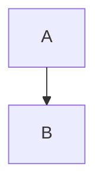

# gospelo-md2html

Markdown を取り込み、ページ割り済みの **Gospelo Document** (`<name>.gospelo.html`) を書く。
編集対象はその HTML の先頭にあるエンベロープ JSON (`<script id="gospelo-document">`) だけで、
`check` / `build` はその HTML を入力にして同じファイルを再生成する。Mermaid 図はビルド時に
Chromium で描いて SVG として書き込む (既定の `--mermaid-lib prerender`。ソースはエンベロープに残る)。
ページ割りは Playwright (Chromium) で実測する。

レイアウトの要約は `references/` にある。設計の根拠 (判断事項、ページ割りアルゴリズムの詳細)
はリポジトリ `gospelo-dev/md2html` のメンテナ用 `development/docs/` にあり、スキル本体には含めない。

## 前提

- `uv` が必要。Python パッケージは `scripts/md2html.py` 先頭の PEP 723 宣言から
  uv が解決するので、pip や venv は使わない。
- 初回だけ Chromium を入れる:

```bash
uv run <skill>/scripts/md2html.py setup
```

- Mermaid の ELK レイアウトを使うときは、初回だけ ELK のバンドルを作る (Node.js と npm が必要。
  ネットワークを使うのはこのときだけ)。下の「Mermaid の ELK レイアウト」を参照:

```bash
uv run <skill>/scripts/md2html.py setup --elk        # Chromium と ELK
uv run <skill>/scripts/md2html.py setup --elk-only   # ELK だけ
```

## 手順 (Agent が守ること)

1. `import --dry-run` でページ数と警告を確認し、利用者に見せる。
2. `import` で `<name>.gospelo.html` を書く。以降の編集対象はこのファイルのエンベロープ JSON だけ。
3. 内容を直すときは、エンベロープ JSON の該当ページの `blocks` だけを編集する
   (`references/editing_guide.md`)。描画済みの `<section class="page">` 以下と CSS は編集しない
   (再生成で上書きされる)。レイアウト設定もエンベロープの `layout` にあるので、
   オプションの再指定は不要。
4. 編集後は `check --report` で残り容量と自動送り (`spills`) を確認する。
   内容を削ってページに収めることはしない。
5. `build` で同じ HTML を再生成する (`--pdf` で PDF も)。はみ出しは同じタイトルの続きページへ
   自動で送られ、エンベロープに書き戻される。
6. 生成した HTML を Playwright / puppeteer でスクリーンショットし、はみ出しや
   図の過小縮小がないことを見てから完了を報告する。レポートの警告は必ず伝える。
7. `--reflow` (ページ割り全体のやり直し) と `import --force` (編集を捨てる)
   は利用者の指示があるときだけ使う。
8. ページ 0 (原文 Markdown のバックアップ) は編集しない。巻き戻しは
   `restore` で原文を取り出してから `import --force`。
9. 0.2 より前の md2html が書いた HTML / JSON は読めない (エラーに移行手順の URL が出る)。
   `scripts/extract_markdown.py` で原文を取り出して `import` し直す。
10. `--pptx` を使うときは、利用者に「各ページを画像にした見た目固定の PPTX で、PowerPoint 上で
    文字や表は編集できない。編集は `.gospelo.html` を直して `build` し直す」と必ず伝える。
    相手が PowerPoint で編集したい場合には向かない。フォント置換を避けたい配布や、`.pptx`
    指定の提出先に向く。検索やコピーが必要なら `--pptx-text` を付ける。

## コマンド

```bash
S=<skill>/scripts/md2html.py
uv run $S import  INPUT.md --page 16x9 --font-size 14pt [--dry-run] [--force]   # INPUT.gospelo.html を書く
uv run $S import  INPUT.md -o out/deck.gospelo.html --page 16x9 --font-size 14pt
uv run $S check   out/deck.gospelo.html --report report.json                      # 何も書かない
uv run $S build   out/deck.gospelo.html [--pdf out/deck.pdf] [--pptx out/deck.pptx] [--reflow] [--font-size 12pt]   # 同じファイルを再生成 (PDF / PPTX も)
uv run $S restore out/deck.gospelo.html -o original.md
uv run $S import  INPUT.md -o content.gospelo.json --page a4   # 分離 JSON (任意)。build で HTML にする
python <skill>/scripts/extract_markdown.py old.html -o original.md   # 旧形式からの移行
```

用紙: `a4` (既定) / `a4-landscape` / `a3` / `a3-landscape` / `16x9` / `4x3`。
文字サイズの既定は A4 11pt、A3 12pt、スライド 14pt。用紙と文字サイズは `import`
に渡す (ページ割りに使う)。`build` で変えるときは `--reflow`。フォントは `--font-family` と
`--code-font-family` (CSS の font-family リスト) で差し替えられ、エンベロープの `layout` に記録される。
PDF を小さく保つには glyf 形式の静的フォント (BIZ UD、Noto Sans JP の静的 TTF) を選ぶ。CFF 形式の
Hiragino は埋め込めず、可変フォントはアウトライン化されるため、どちらも PDF が大きくなる。
既定では同梱の BIZ UD (OFL) を文書で使う文字だけに絞って `@font-face` で HTML に埋め込むので、
閲覧側にフォントは不要 (15 ページで約 0.3MB 増)。`--no-embed-fonts` でやめられる。
`--font-family` で別の書体を指定した場合、その書体は埋め込まれない (閲覧側に必要)。

段組 (`--columns`): 横長の用紙は既定で 2 段組 (`two`: 左段 → 右段。左段の上から下へ、次に右段へ
流す。列数 4 以上の表、コード、横長の図は幅いっぱいの帯)、縦長は単段 (`single`)。
`split` は図 1 枚をテキストの隣に置く形式。ページやブロック単位の変更はレイアウトの
`overrides` (`columns`、`span`)。

レイアウトの詳細は `references/page_formats.md`、ページ区切りの規則は
`references/layout_rules.md`、ファイル形式は `references/gospelo-document.schema.json`
(エンベロープ) と `references/layout.schema.json` (`--layout` に渡すレイアウト JSON)。

## Mermaid の ELK レイアウト

mermaid ブロックで ELK を指定すると、測るとき (`import`) も最終の出力 (`build`、HTML と PDF) も
ELK で描く。指定の書き方は次のどれか:

````markdown



````

- 使える名前は `elk` (elk.layered)、`elk.stress`、`elk.force`、`elk.mrtree`、`elk.sporeOverlap`。
- 使う版は @mermaid-js/layout-elk **0.2.0** (elkjs 0.9.3)。同梱の Mermaid 11.12.2 と組にしてある
  (`scripts/md2html/assets.py` の `MERMAID_LAYOUT_ELK`)。
- バンドルはリポジトリに含めない (elkjs は EPL-2.0)。`setup --elk` が
  `references/vendor/mermaid-layout-elk/build/` の手順 (版を固定した `package.json`) で、利用者の
  キャッシュ `${XDG_CACHE_HOME:-~/.cache}/gospelo-md2html/mermaid-layout-elk/0.2.0/` に作る
  (環境変数 `GOSPELO_MD2HTML_CACHE_DIR` で `gospelo-md2html/` の場所を変えられる)。
- フォールバックはしない。ELK を指定したのにバンドルがない、読み込めない、または上の名前以外の
  `elk*` を指定した場合は、既定 (dagre) で描かずにエラーで止まる (終了コード 1)。
  バンドルがないときは `setup --elk` を実行する。
- ELK を指定していない図の描かれ方は変わらない。出力にも ELK は入らない。
- 既定の `prerender` の出力には、ELK で描いた SVG だけが入る (elkjs は入らない)。`embed` / `link`
  では、ELK を指定した図があるときだけ、ELK のバンドルとそのライセンス (EPL-2.0 を含む) が HTML に
  入る (`link` は `mermaid-layout-elk-0.2.0.min.js` を出力の横に写す)。そうした HTML を配るときは、
  `THIRD_PARTY_NOTICES.md` を参照。

## 警告への対処

| 警告 | 対処 |
| --- | --- |
| figure scaled to < 0.5 | 図が段に対して大きすぎる。2 段ではそのブロックを `overrides` で `span: 2` (帯) にするか、Mermaid の `direction` を変えるか、図を分ける。`split` ならそのページを `columns: single` にする |
| header title truncated | h2 が長い。h2 を短くするか `--header-title fixed:<text>` |
| block ... taller than a page | 1 ブロックがページに入らない (表の 1 行が巨大など)。内容の構造を見直す提案をする |
| droppedDetails | `<details>` を捨てた。本文として必要なら `--details expand` |
| droppedListBlocks | 入れ子のリストの項目の中にあったコード、表、引用などを捨てた (入れ子の項目は文字と子のリストしか持てない)。一番外のリストの項目の中なら、リストを区切ってブロックとして残すので、このメモは出ない。残したいなら Markdown で一番外の項目の下に移す |
| verification did not converge (終了コード 2) | 3 回送っても収まらない。レポートのページを利用者に示す |
| the layout-elk ... bundle is not built | ELK を指定した図がある。`setup --elk` を実行してから同じコマンドをやり直す |
| diagram requests layout ..., which is not an ELK layout | `layout:` の名前の誤り。上の ELK の名前に直す |
| no gospelo-document envelope found | 0.2 より前の出力。`extract_markdown.py` で原文を取り出して `import` し直す |

## 終了コード

0 = 成功 (自動送りが起きても 0)、1 = 入力や依存関係のエラー、2 = 検証が収束しない。
