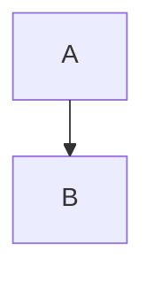

# gospelo-md2html

Markdown を取り込み、ページ割り済みの **Gospelo Document** (`<name>.gospelo.html`) を書く。
編集対象はその HTML の先頭にあるエンベロープ JSON (`<script id="gospelo-document">`) だけで、
`check` / `build` はその HTML を入力にして同じファイルを再生成する。Mermaid 図はビルド時に
mermaid-arch (Mermaid 12) で描いて SVG として書き込む (ソースはエンベロープに残る)。
AWS アイコン入りの構成図も描ける (`--icons-zip`)。ページ割りは chrome-headless-shell で実測する。

本体は TypeScript (Node.js) の `scripts/md2html.mjs`。`scripts/md2html.py` はそれを呼ぶだけの
ラッパーで、引数と終了コードはそのまま渡す。

レイアウトの要約は `references/` にある。設計の根拠 (判断事項、ページ割りアルゴリズムの詳細)
はリポジトリ `gospelo-dev/md2html` のメンテナ用 `development/docs/` にあり、スキル本体には含めない。

## 前提

- Node.js 22.12 以上と npm が必要。`uv` (または python3) はラッパーを動かすのに使う。
- スキルを入れた先で初回だけ `setup` を実行する。npm パッケージ (`npm ci`) と
  chrome-headless-shell (puppeteer の cache) を入れる:

```bash
uv run <skill>/scripts/md2html.py setup
```

- ブラウザは `--chrome PATH`、`CHROME_PATH`、`PUPPETEER_EXECUTABLE_PATH`、puppeteer の cache
  の順に探す。見つからないときはエラーに入れ方のコマンドが出る。

## 手順 (Agent が守ること)

1. `import --dry-run` でページ数と警告を確認し、利用者に見せる。
2. `import` で `<name>.gospelo.html` を書く。以降の編集対象はこのファイルのエンベロープ JSON だけ。
3. 内容を直すときは、エンベロープ JSON の該当ページの `blocks` だけを編集する
   (`references/editing_guide.md`)。描画済みの `<section class="page">` 以下と CSS は編集しない
   (再生成で上書きされる)。レイアウト設定もエンベロープの `layout` にあるので、
   オプションの再指定は不要。
4. 編集後は `check --report` で残り容量と自動送り (`spills`) を確認する。
   内容を削ってページに収めることはしない。
5. `build` で同じ HTML を再生成する (`--pdf` で PDF も)。はみ出しは同じタイトルの続きページへ
   自動で送られ、エンベロープに書き戻される。
6. 生成した HTML をブラウザでスクリーンショットし、はみ出しや
   図の過小縮小がないことを見てから完了を報告する。レポートの警告は必ず伝える。
7. `--reflow` (ページ割り全体のやり直し) と `import --force` (編集を捨てる)
   は利用者の指示があるときだけ使う。
8. ページ 0 (原文 Markdown のバックアップ) は編集しない。巻き戻しは
   `restore` で原文を取り出してから `import --force`。
9. 0.2 より前の md2html が書いた HTML / JSON は読めない (エラーに移行手順の URL が出る)。
   `scripts/extract_markdown.py` で原文を取り出して `import` し直す。
10. `--pptx` を使うときは、利用者に「各ページを画像にした見た目固定の PPTX で、PowerPoint 上で
    文字や表は編集できない。編集は `.gospelo.html` を直して `build` し直す」と必ず伝える。
    相手が PowerPoint で編集したい場合には向かない。フォント置換を避けたい配布や、`.pptx`
    指定の提出先に向く。検索やコピーが必要なら `--pptx-text` を付ける。
11. AWS アイコン (`aws:lambda` など) を使う図があるときは、利用者が手元に置く AWS
    Architecture Icons の zip (`Icon-package_*.zip`) の場所を `--icons-zip` で渡す
    (`import` / `check` / `build` のたびに必要。文書には記録しない)。場所が分からなければ
    利用者に聞く。推測したパスや別のアイコンで代用しない。アイコンは描いた図の一部としてだけ
    文書に入り、アイコンの集まり (アイコンパック) は文書にもファイルにも出ない。
12. Python 版 (0.6 以前) で作った文書を `build` すると、Mermaid の版の違い (11.12.2) で止まる。
    図の大きさやページの切れ目が変わってよいかを利用者に確かめてから、エラーが示す
    `--mermaid-version` を付けて `build` する。`mermaidLib` が `embed` / `link` の文書も同様に、
    `--mermaid-lib prerender` を付ける。

## コマンド

```bash
S=<skill>/scripts/md2html.py
uv run $S import  INPUT.md --page 16x9 --font-size 14pt [--dry-run] [--force]   # INPUT.gospelo.html を書く
uv run $S import  INPUT.md -o out/deck.gospelo.html --page 16x9 --font-size 14pt
uv run $S check   out/deck.gospelo.html --report report.json                      # 何も書かない
uv run $S build   out/deck.gospelo.html [--pdf out/deck.pdf] [--pptx out/deck.pptx] [--reflow] [--font-size 12pt]   # 同じファイルを再生成 (PDF / PPTX も)
uv run $S restore out/deck.gospelo.html -o original.md
uv run $S import  INPUT.md -o content.gospelo.json --page a4   # 分離 JSON (任意)。build で HTML にする
uv run $S import  INPUT.md --page 16x9 --icons-zip "<path to Icon-package_*.zip>"   # AWS アイコン入りの図
python <skill>/scripts/extract_markdown.py old.html -o original.md   # 旧形式からの移行
```

Mermaid 図は Mermaid 12 で描く。AWS アイコンは
`fn@{ icon: "aws:lambda", form: "square", label: "Handler" }` (flowchart) や
`service fn(aws:lambda)[Handler]` (architecture-beta) の形で書く。図のラベルに `fa:fa-user`
のような Font Awesome のアイコンがあると、Font Awesome Free を HTML に埋め込む。

用紙: `a4` (既定) / `a4-landscape` / `a3` / `a3-landscape` / `16x9` / `4x3`。
文字サイズの既定は A4 11pt、A3 12pt、スライド 14pt。用紙と文字サイズは `import`
に渡す (ページ割りに使う)。`build` で変えるときは `--reflow`。フォントは `--font-family` と
`--code-font-family` (CSS の font-family リスト) で差し替えられ、エンベロープの `layout` に記録される。
PDF を小さく保つには glyf 形式の静的フォント (BIZ UD、Noto Sans JP の静的 TTF) を選ぶ。CFF 形式の
Hiragino は埋め込めず、可変フォントはアウトライン化されるため、どちらも PDF が大きくなる。
既定では同梱の BIZ UD (OFL) を文書で使う文字だけに絞って `@font-face` で HTML に埋め込むので、
閲覧側にフォントは不要 (15 ページで約 0.3MB 増)。`--no-embed-fonts` でやめられる。
`--font-family` で別の書体を指定した場合、その書体は埋め込まれない (閲覧側に必要)。

段組 (`--columns`): 横長の用紙は既定で 2 段組 (`two`: 左段 → 右段。左段の上から下へ、次に右段へ
流す。列数 4 以上の表、コード、横長の図は幅いっぱいの帯)、縦長は単段 (`single`)。
`split` は図 1 枚をテキストの隣に置く形式。ページやブロック単位の変更はレイアウトの
`overrides` (`columns`、`span`)。

レイアウトの詳細は `references/page_formats.md`、ページ区切りの規則は
`references/layout_rules.md`、ファイル形式は `references/gospelo-document.schema.json`
(エンベロープ) と `references/layout.schema.json` (`--layout` に渡すレイアウト JSON)。

## Mermaid の配置 (ELK と dagre)

Mermaid 12 は ELK を含むので、ELK を使うための準備は要らない (Python 版の `setup --elk` は
なくなった)。flowchart は何も指定しないと ELK (`elk`) で並ぶ。図ごとに指定するときの書き方は
次のどれか:

````markdown



````

- 使える名前は `dagre`、`swimlane`、`cose-bilkent`、`elk` (elk.layered)、`elk.stress`、
  `elk.force`、`elk.mrtree`、`elk.sporeOverlap`、`elk.box`、`elk.rectpacking`
  (Mermaid 12.3.0 が登録している名前)。Python 版 (Mermaid 11 の dagre) の並び方にしたい図は
  `layout: dagre` を書く。
- フォールバックはしない。Mermaid は知らない名前を黙って dagre で描くので、md2html は描く前に
  front matter と `%%{init}%%` の `layout` / `defaultRenderer` を確かめ、上の名前以外ならエラーで
  止まる (終了コード 1)。
- 出力には描いた SVG だけが入る。elkjs (EPL-2.0) は Mermaid 12 のバンドルの中にあり、`setup` が
  npm から各自の `node_modules` に入れる。リポジトリにも出力にも elkjs は入らない
  (`THIRD_PARTY_NOTICES.md`)。

## 警告への対処

| 警告 | 対処 |
| --- | --- |
| figure scaled to < 0.5 | 図が段に対して大きすぎる。2 段ではそのブロックを `overrides` で `span: 2` (帯) にするか、Mermaid の `direction` を変えるか、図を分ける。`split` ならそのページを `columns: single` にする |
| header title truncated | h2 が長い。h2 を短くするか `--header-title fixed:<text>` |
| block ... taller than a page | 1 ブロックがページに入らない (表の 1 行が巨大など)。内容の構造を見直す提案をする |
| droppedDetails | `<details>` を捨てた。本文として必要なら `--details expand` |
| droppedListBlocks | 入れ子のリストの項目の中にあったコード、表、引用などを捨てた (入れ子の項目は文字と子のリストしか持てない)。一番外のリストの項目の中なら、リストを区切ってブロックとして残すので、このメモは出ない。残したいなら Markdown で一番外の項目の下に移す |
| verification did not converge (終了コード 2) | 3 回送っても収まらない。レポートのページを利用者に示す |
| icons-zip-missing / no AWS icon zip was given | 図が `aws:` アイコンを使っている。利用者に zip の場所を聞いて `--icons-zip` で渡す |
| Mermaid cannot parse or draw this diagram | エラーの `diagram N = block <id>` で該当の図を特定し、Mermaid の書き方を直す |
| paginated with Mermaid 11.12.2 | Python 版で作った文書。手順 12 のとおり利用者に確かめてから `--mermaid-version` を付ける |
| chrome-missing | chrome-headless-shell がない。`setup` を実行するか、エラーに出たコマンドで入れる |
| block ... asks for layout '...', which Mermaid ... does not have | `layout:` の名前の誤り。上の「Mermaid の配置」の名前に直す |
| vendor-missing / vendor-mismatch (mermaid) | Mermaid 12.3.0 が入っていないか、版や中身が違う。`setup` を実行し直す |
| no gospelo-document envelope found | 0.2 より前の出力。`extract_markdown.py` で原文を取り出して `import` し直す |

## 終了コード

0 = 成功 (自動送りが起きても 0)、1 = 入力や依存関係のエラー、2 = 検証が収束しない、
またはオプションの誤り。
