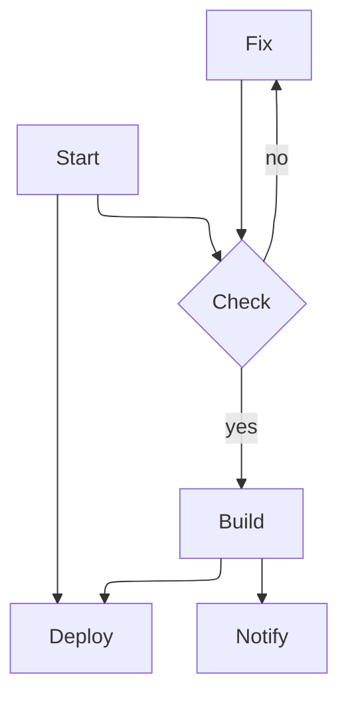
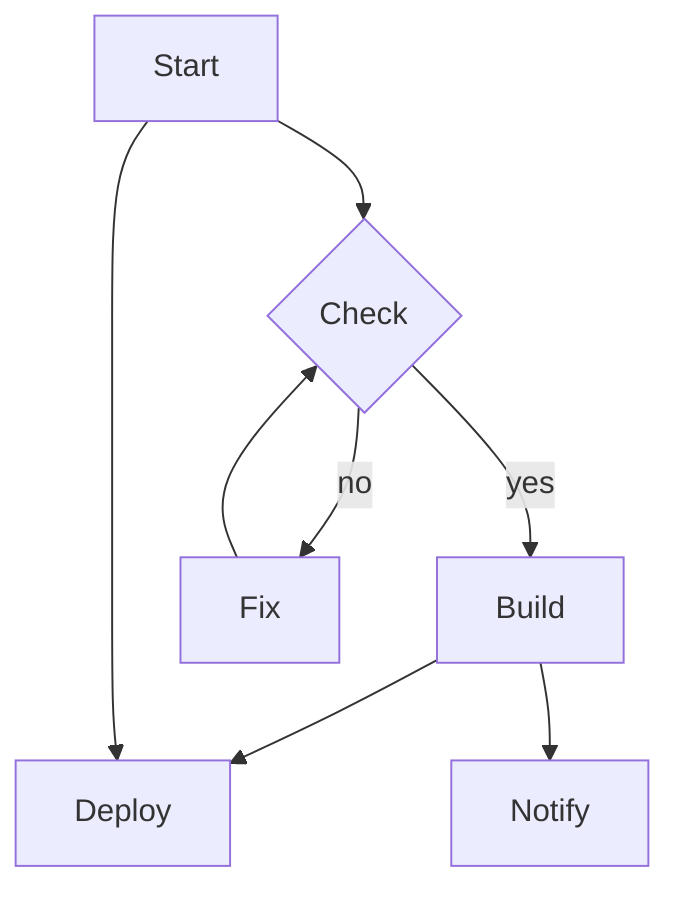

# ELK layout

The same graph five times: three ways of asking for the ELK layout, the
default (also ELK in Mermaid 12), and dagre for comparison.

## init directive

## front matter

## flowchart-elk

## default layout

## dagre

